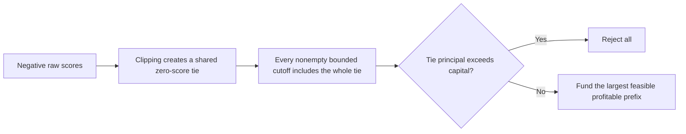

# Professor Model — Post-10B Results Review and Next Study

Reviewed **2026-10-28**. This is a post-hoc audit of saved evidence and a
follow-up design draft. No new population, noise, fit, or policy optimization
was run. The [completed Step 10B report](professor_fixed_coefficient_comparison.md)
and all its frozen artifacts remain unchanged. The
[Step 10A roadmap](professor_model_next_steps.md) is a historical proposal;
Step 10B has since completed both its canonical and 200-draw comparisons.

## Do the results make sense?

**Yes, under the implemented equations and policy restrictions.** The large
profit swings have an identifiable mechanical explanation, rather than a
contradiction in the saved accounting. This does not establish that the
contract is realistic or that any policy is universally better or fairer.

The important distinction is between three policies:

- **W:** the frozen group-aware regression and lending decisions.
- **Z:** remove only W's saved B contribution, preserve its other coefficients
  and intercept, clip to [0,1], and optimize its own common cutoff.
- **F:** the existing fully refitted group-blind model and frozen decisions.

One canonical noise realization gives the following results. These are not
200-draw averages.

| Quantity | W: aware | Z: coefficient removed | F: blind refit |
|---|---:|---:|---:|
| Approvals | 3,900 | 3,802 | 3,802 |
| B=1 minus B=0 approval gap | −14.385705 pp | +0.155468 pp | +0.155468 pp |
| True expected portfolio profit | $2,366,074,476.85 | $2,366,927,525.69 | $2,366,599,763.61 |
| Bounded true-PD MAE, probability units | 0.0004903232 | 0.0004389398 | 0.0004559405 |

Z and F fund the same number in each group, but exchange one borrower. Their
$327,762.07 Z−F profit difference is therefore compatible with identical
group approval rates. Z−W profit is +$853,048.84. Neither canonical result
generalizes automatically to the other noise realizations.

## New finding 1: the cutoff is capital-limited throughout

All **603 policy cases**—three policies times 201 cases—have all requests
perceived as profitable, select the largest feasible cutoff, and report that
the next prefix is capital-infeasible. The review independently replayed the
saved linear scores to check this against the contract's break-even risk.

For the existing contract, define `q=(1+r)(1-p)`. Then

\[
\Pi_i(p)=\ell_i\left(\sum_{t=1}^{30}q^t-30\right),
\qquad p_{break-even}=r/(1+r)=4.76190476\%.
\]

The maximum replayed evaluation PD across all policies/cases is **1.716261%**,
below break-even. Maximum evaluator true PD is **0.862209%**, and every
evaluation request is truly profitable under this same accounting. With
positive incremental profits and nested common-cutoff portfolios, perceived
profit increases whenever a whole score group is added. The best feasible
prefix is consequently the largest feasible prefix.

This is valid optimization over the declared restricted family. It primarily
studies **ranking, indivisible score groups, request size and scarce capital**.
It does not yet test screening a mix of profitable and unprofitable requests,
and it is not unrestricted profit-per-dollar portfolio selection.

The large dollar values are undiscounted totals from growing payments over 30
unspecified periods, with 5% interest **per period** and no funding costs,
recovery, prepayment or discounting. They are internally defined synthetic
values, not annual bank profits or realistic mortgage return estimates.
Do not change the equations to make the results look more realistic after
seeing them; a revised contract would be a separate study.

## New finding 2: rare reject-all disagreements dominate profit means

Clipping collapses negative raw scores into one exact zero-score tie. With
indivisible ties, a nonempty bounded-score cutoff must include that entire
block. If its requested principal exceeds capital, **every nonempty cutoff
is infeasible**, even though its loans individually have positive perceived
profit. Reject-all is then correct under the specified policy restrictions.



The last branch describes the observed cases, not every conceivable dataset.
All 603 saved zero-block counts and principal sums were independently replayed
from the frozen coefficients and contracts: the maximum dollar residual was
**$0.00**. Reject-all matches an oversized zero block in every saved case.

The following partition explains the existing means. Contributions divide
the sums by the **full 200-draw denominator** and therefore add to the full
mean. No draw is removed from the primary analysis.

| Paired comparison | Draws where only one policy rejects all | Their contribution to full mean | All remaining draws' contribution | Full mean |
|---|---:|---:|---:|---:|
| Z−W | 3 | +$11,879,862.15 | +$940,737.27 | +$12,820,599.42 |
| Z−F | 5 | −$11,763,301.84 | −$32,328.50 | −$11,795,630.33 |
| F−W | 2 | +$23,635,608.34 | +$980,621.41 | +$24,616,229.75 |

For example, the five diagnostic draws have these zero-block costs and
approvals. Costs are percentages **of the fixed capital budget**, not applicant
shares. A value above 100% prevents any nonempty bounded cutoff.

| Saved draw | W / Z / F zero-block cost, % of budget | W / Z / F approvals |
|---|---|---|
| 008 | 110.013 / 128.433 / 96.303 | 0 / 0 / 4,744 |
| 064 | 108.139 / 95.557 / 105.809 | 0 / 3,701 / 0 |
| 089 | 96.384 / 107.286 / 91.144 | 4,331 / 0 / 4,161 |
| 092 | 113.084 / 131.415 / 91.667 | 0 / 0 / 3,861 |
| 154 | 115.537 / 91.339 / 118.701 | 0 / 3,454 / 0 |

These post-hoc partitions diagnose the implemented rule; they are neither
trimmed estimates nor an additive causal decomposition. The 200-draw Z−W
median is +$592,951.23 and Z−F median is $0.00. Their mean MCSEs are $20.53M
and $26.50M, respectively, exceeding the absolute mean differences. Report
means alongside medians, extrema, sign counts and reject-all frequencies.
The empirical 2.5/97.5 percentiles do not include all rare billion-dollar
differences and are not confidence intervals for the mean.

## New finding 3: coefficient removal is not blind refitting

Let X contain `[1,Y,D,C]`. The two saved regressions use the same training
rows and target. The OLS normal equations imply

\[
\widehat\beta_X^F=\widehat\beta_X^W+
\widehat\beta_B^W\widehat\delta,
\qquad
raw_F-raw_Z=\widehat\beta_B^W X\widehat\delta,
\]

where delta is the training linear projection of B on X. This review derives
delta **algebraically from saved coefficients**, without fitting B~X or
refitting either bank. Checking the projection normal equations gives maximum
absolute residual moment **1.22e−9**, after dividing each X-column moment by
its RMS, across all 201 cases. The score identity alone is algebraic; the
normal-equation check supports the projection interpretation independently.

The canonical implied B projection has training mean **0.150500** and
evaluation mean **0.150493**, with evaluation SD **0.000954**. Consequently
the blind refit raises Z's raw score by almost a constant:

- Mean F−Z shift: **0.0001069295534 probability units**, or **0.010692955 pp**.
- SD of that shift: **0.0000006775486 probability units**.
- Canonical raw-rank Spearman correlation: **0.999999463**.
- Smallest raw-rank correlation over all 201 cases: **0.999921836**.

Thus F largely restores an average level contribution that Z deliberately
leaves out, with small slope changes. A constant shift would preserve raw
ranking; clipping can still change the zero block and available bounded-score
prefixes. The actual shift is not exactly constant, so some ordering changes
also occur. This explains why very similar raw rankings can coexist with
different clipped ties and, occasionally, an all-or-nothing lending outcome.
It does not by itself isolate the allocation effect of clipping.

The B coefficient is positive in 105 and negative in 95 of the 200 saved
noise fits. The underlying professor-model population and true-risk equation
contain no B treatment. A fitted B contribution is therefore not a known
causal group default effect or evidence of an encoded discrimination mechanism.
PN remains a noisy continuous target; neither clipping nor coefficient
removal turns these estimates into calibrated default probabilities.

## Claims supported and claims to avoid

| Supported by current evidence | Not established |
|---|---|
| Coefficient removal improves true profit relative to W in 138/200 draws and relative to F in 69/200 | Universal profit improvement or a reliable ranking from the mean sign |
| Z has a smaller absolute approval gap than W in 183/200 draws | A complete fairness conclusion or proof of real-world discrimination |
| The frozen tie/capital rule explains saved reject-all cases exactly | That lenders must reject all in practice, or that tie splitting would necessarily improve true profit |
| F and Z raw rankings are extremely similar | Exact equality of their scores, portfolios, calibration or economic value |
| All results condition on one population, split, risk equation and contract | Independent-population uncertainty or external validity |

## Prepared next step: raw-ordering sensitivity, design draft only

The most informative next question is:
**Does preserving the raw score ordering change the extreme outcomes while
keeping probability-based accounting unchanged?**

This is a policy-class sensitivity, not a new fitted risk model or a change
to the professor's original bounded-PD threshold. It requires an explicit
research decision because it changes what scores the cutoff orders.

| Element | Proposed fixed design |
|---|---|
| Inputs | Same saved applicants, split, W/Z/F coefficients, contracts and exact capital |
| Baselines | Original W/Z/F policies stay frozen; verify their recorded masks and objectives |
| New ordering | Use each policy's finite raw score only to order applicants and define a common prefix; negative scores are ranks, never default probabilities |
| Economic probabilities | Use exactly the corresponding existing `clip(raw,0,1)` PD for survival, receipts and perceived profit |
| Constraints | Same full requests, no skipping, exact raw-score ties indivisible, separate reject-all and original exact objective tie rule |
| Pilot cases | Canonical plus saved draws 008, 064, 089, 092 and 154; these are deliberately selected mechanism diagnostics, not a random uncertainty sample |
| Estimands | Within-model raw-order minus bounded-order approvals, capital, perceived/true profit, group gap and overlap; preserve W/Z/F comparisons separately |
| Information boundary | Freeze all new scores, assessments, candidates and decisions before evaluator truth; no fitting, new noise or outcome-based policy tuning |
| Acceptance checks | Bounded accounting scores unchanged; every original bounded prefix remains available in the raw-prefix family; exact feasible-set/objective checks; original-dollar budget respected; deterministic reruns |

Because clipping is monotone, each original bounded-score prefix is also a
raw-score prefix. The new family can add endpoints *inside* a formerly
clipped tie without splitting any exact raw-score tie. Its maximized
**perceived** profit therefore cannot fall relative to that model's original
bounded-prefix optimum. This is a mathematical consistency check, not an
expected true-profit or fairness improvement. True profit can move either
way, and a minimum raw-score block could still be too expensive.

Implementation should keep the ranking key and accounting PD as distinct
fields in a new isolated policy module. Never pass negative raw scores to
the existing bounded-probability API or relax its validation. Validate the
small diagnostic set before considering the full 200-draw extension. No
policy in this proposed study has been implemented or optimized here.

Professor discussion should settle whether bounded PD itself must define
the threshold, or whether a raw ordering score is acceptable when cash flows
still use valid probabilities. Independently confirm the payment/rate/time
interpretation and PN noise scale before a realism-oriented extension.
Changing those together with tie rules would obscure which mechanism matters.

## Reproduction and validation

The new audit runner defaults to read-only and imports no simulation, fitting
or lending-search code:

```bash
python3 experiments/review_professor_fixed_coefficient.py
# Explicitly save a separate immutable review; no scientific artifacts overwritten:
python3 experiments/review_professor_fixed_coefficient.py --write
```

Source tables are the canonical/noise policy, paired and summary CSVs under
`results/tables/professor_model/fixed_coefficient/cd7f3ee268cfc4d0/`.
Per-case bank freezes and final validation are under the matching metrics
directory. The new machine-readable review is
[cb0076a743e664e2.json](../results/metrics/professor_model/post10b_review/cb0076a743e664e2.json).
It records source hashes, all 201 coefficient-algebra diagnostics and the
post-hoc mean partition; it is evaluator-only and not a new policy artifact.

Fresh checks verified **1,018 original-file hashes**, **628 Step 10B artifact
hashes**, all **26 Step 10B evidence-index artifacts**, and the historical
Step 10A index core. Independent zero-block replay matched all 603 counts and
costs exactly. The new review tests passed **16/16**. The combined relevant
bank-regression, blind-model, accounting, cutoff, Step 10B and review suite
passed **206 tests with no warnings**. The complete repository
suite was not rerun; the four known V2 checkpoint-identity lookup failures
remain unresolved. Historical test totals are not relabeled as fresh runs.

All original scientific implementations, configurations, datasets, decisions
and frozen reports remain unchanged. No models, new draws, new cutoff
searches, ML/HMDA extensions, commits or pushes were performed in this review.
